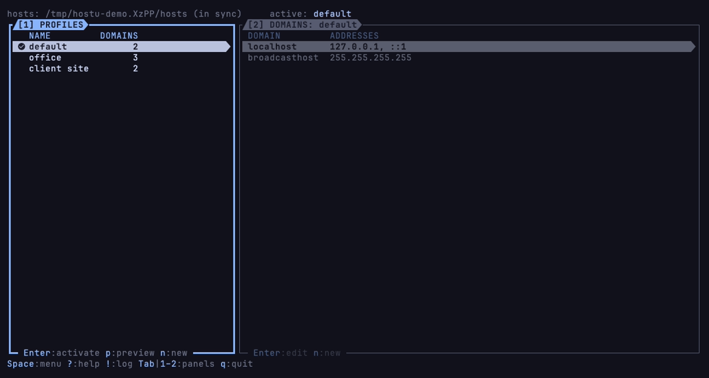

# hostu

[](https://github.com/vulcanshen/hostu/releases)
[](LICENSE)

**Language**: English · [繁體中文](README-zh_TW.md)

**Switch the hosts file between profiles, in the terminal.**

Keep a few sets of hosts entries as profiles — the office, home, a client's site — and write the one you need into the
hosts file with one key. Each profile is a list of domains, each going to one address or more; you add and change them
one at a time in a form, never by editing the hosts file. The first time it starts, hostu reads your hosts file as it is
into a profile named `default`, so nothing you had is lost.



## Features

- **One active profile, marked**: a green tick shows which profile the hosts file has; the statusbar says when the hosts
  file differs from it (you changed the profile since, or another program wrote the file).
- **A domain at a time**: add, change and delete domains in a form; a domain can go to several addresses (IPv4 and IPv6).
  Wrong names and addresses are caught as you type them.
- **Writes only when you say so**: changing a profile changes only hostu's own `profiles.yaml`; the hosts file is written
  when you activate a profile, after a question that says how much it writes and warns when `localhost` is missing.
- **Your old hosts file is kept**: before hostu first writes the hosts file, it keeps a copy of it as it was.
- **Asks for sudo only to write**: run hostu as yourself; when the hosts file needs the administrator, hostu asks for
  sudo's password in a small popup and hands it to sudo alone (doas asks in a terminal inside hostu; on Windows, the
  system's UAC window).
- **Profiles from the hosts file**: read the hosts file as it is now into a new profile at any time.

## Install

### Requirements

- macOS, Linux or Windows.
- To write the system's hosts file: `sudo` or `doas` on macOS and Linux; on Windows `gsudo` or the `sudo` of Windows 11.
- A [Nerd Font](https://www.nerdfonts.com) terminal profile: the icons and the frames are Nerd Font glyphs.
- A truecolor (24-bit) terminal: the faded colours and the layer colours cannot be told apart in 256 colours.
- A terminal at least 60 columns wide and 24 rows high; in a smaller one hostu shows only its name, the size it needs
  and how to quit (`Ctrl-C` twice), and comes back as it was once the terminal grows.

hostu measures how many cells an icon and a powerline symbol take when it starts. When it gets them wrong, set them:

| Variable | What it sets |
|---|---|
| `HOSTU__ICON_WIDTH` | The cells an icon takes, for hostu |
| `HOSTU__POWERLINE_WIDTH` | The cells a powerline symbol takes, for hostu |
| `TERMINU__ICON_WIDTH` | The cells an icon takes, for every terminu family app: set it once and they all read it |
| `TERMINU__POWERLINE_WIDTH` | The cells a powerline symbol takes, for every terminu family app |
| `LC_TERMINU_ICON_WIDTH` | The cells an icon takes, brought over ssh by a family app with ssh |
| `LC_TERMINU_POWERLINE_WIDTH` | The cells a powerline symbol takes, brought over ssh by a family app with ssh |

For an icon and for a powerline symbol each, hostu takes the first one set in the order of the table, and measures only
when none is. Run inside a family app's terminal, hostu gets the `TERMINU__` ones from the app around it; reached over
ssh from one, the `LC_TERMINU_` ones.

### Homebrew

```sh
brew install vulcanshen/tap/hostu
```

### Scoop (Windows)

```powershell
scoop bucket add vulcanshen https://github.com/vulcanshen/scoop-bucket
scoop install hostu
```

### Script

```sh
curl -fsSL https://raw.githubusercontent.com/vulcanshen/hostu/main/install.sh | sh
```

No sudo: it installs to `~/.local/bin`. On Windows, in PowerShell:

```powershell
irm https://raw.githubusercontent.com/vulcanshen/hostu/main/install.ps1 | iex
```

### Go

```sh
go install github.com/vulcanshen/hostu/cmd/hostu@latest
```

### The first start

hostu reads the hosts file into a profile named `default`, marks it active (the hosts file has it) and saves it in
`profiles.yaml`. It does not write the hosts file until you activate a profile.

### Update and uninstall

To update, install again the same way. To uninstall:

```sh
brew uninstall hostu
```

Installed with the script:

```sh
curl -fsSL https://raw.githubusercontent.com/vulcanshen/hostu/main/uninstall.sh | sh
```

```powershell
irm https://raw.githubusercontent.com/vulcanshen/hostu/main/uninstall.ps1 | iex
```

The uninstaller asks before it removes the profiles and the copy of your old hosts file. Uninstalling leaves the hosts
file as hostu last wrote it.

## Quick start

1. Run `hostu`. The profile `default` is your hosts file as it was.
2. Press `n` to make a profile, say `office`; `Tab` goes over to its domains.
3. Press `n` there for a domain: `Enter` on Domain, type `git.corp.local`, `Enter`; `j`, `Enter` on Addresses, type
   `10.1.2.3`, `Enter`; `Tab`, `Enter` adds it.
4. Press `1` to go back to the profiles, then `Enter` on `office`: hostu asks, and `Enter` writes it to the hosts file.
5. `Enter` on `default` puts your old hosts file back. `q` quits.

## Usage

```
hostu            start
hostu version    print the version (-v, --version)
hostu help       print the command-line usage (-h, --help)
```

The keys every family app shares:

| Key | What it does |
|---|---|
| `Space` | What you can do here: on this item, on this panel, and for the whole app |
| `?` | Every key that works here |
| `!` | The App Log: what hostu has done and what went wrong while it has been open |
| `Tab`, `1`–`2` | The other panel; jump to a panel by its number |
| `j\|k` | Move; past the last one you are back at the first |
| `gg\|G` | To the top, to the bottom |
| `Enter` | The obvious thing: activate a profile, edit a domain |
| `Esc` | Close the popup on top, one at a time; it never leaves hostu |
| `q` | Quit |

hostu's own:

| Key | Where | What it does |
|---|---|---|
| `Enter` | `[1] PROFILES` | Activate the profile: write it to the hosts file, after asking |
| `p` | `[1] PROFILES` | Preview the hosts file the profile writes |
| `r`, `c` | `[1] PROFILES` | Rename the profile; copy it to a new one |
| `D` | `[1] PROFILES` | Delete the profile, after asking (not the active one) |
| `n` | `[1] PROFILES` | A new, empty profile |
| `i` | `[1] PROFILES` | Read the hosts file as it is now into a new profile |
| `Enter` | `[2] DOMAINS` | Edit the domain and its addresses |
| `D` | `[2] DOMAINS` | Delete the domain, after asking |
| `n` | `[2] DOMAINS` | A new domain: the NEW DOMAIN form |

In the form, type several addresses in Addresses between spaces: `10.1.2.3 fd00::3`.

## Settings and data

| What | Where | Moved by |
|---|---|---|
| Settings, `config.yaml` | `$XDG_CONFIG_HOME/hostu`, else `~/.config/hostu` | `HOSTU__CONFIG` |
| Profiles, `profiles.yaml` | `~/.hostu` | `HOSTU__DATA` |
| Your hosts file as it was before hostu first wrote it, `hosts.original` | `~/.hostu` | `HOSTU__DATA` |
| The hosts file hostu writes | `/etc/hosts`; on Windows `%SystemRoot%\System32\drivers\etc\hosts` | `HOSTU__HOSTS_FILE` |

On Windows `~` is `%USERPROFILE%`. `config.yaml` has one setting, shared by the terminu family:

| Key | What it does | Default |
|---|---|---|
| `input_tab_width` | How many spaces a tab in the text hostu shows is drawn as | `4` |

`profiles.yaml` is hostu's own; hostu saves it every time you change something. To try hostu without touching your
hosts file, point `HOSTU__HOSTS_FILE` at a copy of it.

When `config.yaml` or `profiles.yaml` can't be read (say, after a change by hand), hostu asks before anything else:
`Enter` renames it to `.bak` and starts as the first time, `Esc` quits and prints the file and what is wrong with it.

## Limits

- hostu writes the whole hosts file from the profile: comments and lines you wrote in the hosts file yourself are not
  kept in it (they are kept in `hosts.original` from the first time). Change the profile in hostu, not the hosts file.
- A line of the hosts file that is not an address and names (a typo, an address hostu does not know) is left out of the
  profile read from it; hostu says how many lines it left out.
- hostu does not watch the hosts file: it reads it when it starts and after it writes it.

## Links

- [CHANGELOG](CHANGELOG.md)

## The terminu family

hostu follows [terminu design](https://github.com/vulcanshen/terminu) and is built with
[terminu-go](https://github.com/vulcanshen/terminu-go).

- [terminu design](https://github.com/vulcanshen/terminu): the design the family's apps follow, and the list of them
- [terminu-go](https://github.com/vulcanshen/terminu-go): the Go library they are built with
- [terminu-harness](https://github.com/vulcanshen/terminu-harness): a Claude Code plugin that makes apps with terminu
  design and terminu-go

## License

[GPL-3.0](LICENSE)
